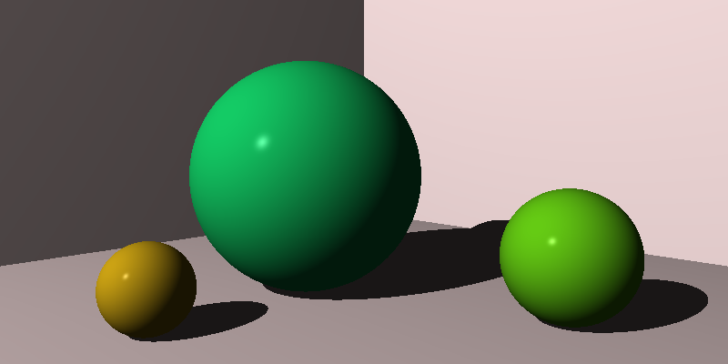

# Ray Tracer

This project is based on the book `The Ray Tracer Challenge` by `Jamis Buck`.

I decided to write it in C, hoping that I could later use it in embedded devices. I now regret. The matrix implementation is a complete piece of garbage (another way to call its inefficiency).

## Compile & Run
Configure and build from the project directory:

```bash
cmake -S . -B build -DCMAKE_BUILD_TYPE=Release
cmake --build build -j
```

Render the Chapter 8 scene:

```bash
./build/raytracer_chapter8
```

The image is saved as `chapter8.bmp` in your current working directory. The
chapter reuses the scene in `main_7.c`, with shadows supplied by the updated
world shading. The original targets are also available: `raytracer` writes
`output1.bmp`, and `raytracer_chapter7` writes `chapter7.bmp` using the same
updated world shading.

Run the tests:

```bash
ctest --test-dir build --output-on-failure
```

`shadows_test` checks all seven Chapter 8 scenarios and fails on incorrect
results even in Release builds. The four older programs remain smoke tests.
To build only the renderers, configure with `-DBUILD_TESTING=OFF`.

## Chapter 8: Shadows

- `light_lighting()` takes an additional `bool in_shadow` argument. A shadowed
  surface receives only ambient illumination; otherwise lighting is unchanged.
- `world_is_shadowed(world, point, light)` casts a ray toward the specified light
  and checks whether the nearest nonnegative hit is closer than the light.
  The light argument fits the world's existing array of light sources.
- Intersection computations include `over_point`, offset along the final normal
  by `INTERSECTION_EPSILON` (`0.00001`) to prevent self-shadowing.
- `world_shade_hit()` uses `over_point` for the visibility check and lighting.
  Temporary shadow-ray intersection lists are deleted after each check.

## Current State


*Chapter 8: Shadows*
